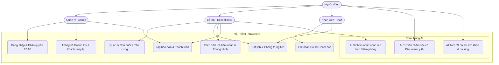
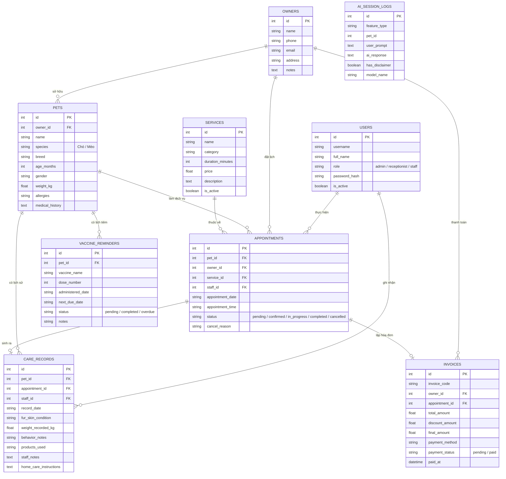

# BÁO CÁO KIỂM TRA 1 (KT1): PHÂN TÍCH NGHIỆP VỤ & THIẾT KẾ HỆ THỐNG

**Trường Đại học Công Nghệ Thông Tin và Truyền Thông (ICTU) - Đại học Thái Nguyên**  
**Học phần:** Ứng dụng trí tuệ nhân tạo (AIA331)  
**Mã số đề tài:** 80286  
**Tên đề tài:** Hệ thống quản lý thú cưng và lịch chăm sóc có tích hợp AI (PetCare AI)  

---

## 1. Phân Tích Nghiệp Vụ Hệ Thống

Cửa hàng dịch vụ thú cưng phục vụ 3 nhóm đối tượng chính:
1. **Chủ nuôi (Pet Owners):** Có nhu cầu đặt lịch spa, tắm sấy, cắt tỉa lông, tiêm phòng và nhận tin nhắn nhắc lịch định kỳ, hướng dẫn chăm sóc cơ bản.
2. **Lễ tân (Receptionist):** Tiếp nhận thông tin chủ nuôi, xếp lịch hẹn, điều phối kỹ thuật viên, lập hóa đơn và theo dõi thanh toán.
3. **Kỹ thuật viên / Chuyên viên chăm sóc (Staff/Groomer):** Thực hiện quy trình spa, ghi nhận thể trạng lông da, cân nặng và dặn dò sau dịch vụ.
4. **Quản lý (Admin):** Toàn quyền kiểm soát danh mục dịch vụ, bảng giá, cấu hình AI, thống kê doanh thu và tỷ lệ khách hàng quay lại.

---

## 2. Biểu Đồ Ca Sử Dụng (Use Case Diagram)

---

## 3. Biểu Đồ Thực Thể Quan Hệ (ERD - Entity Relationship Diagram)

